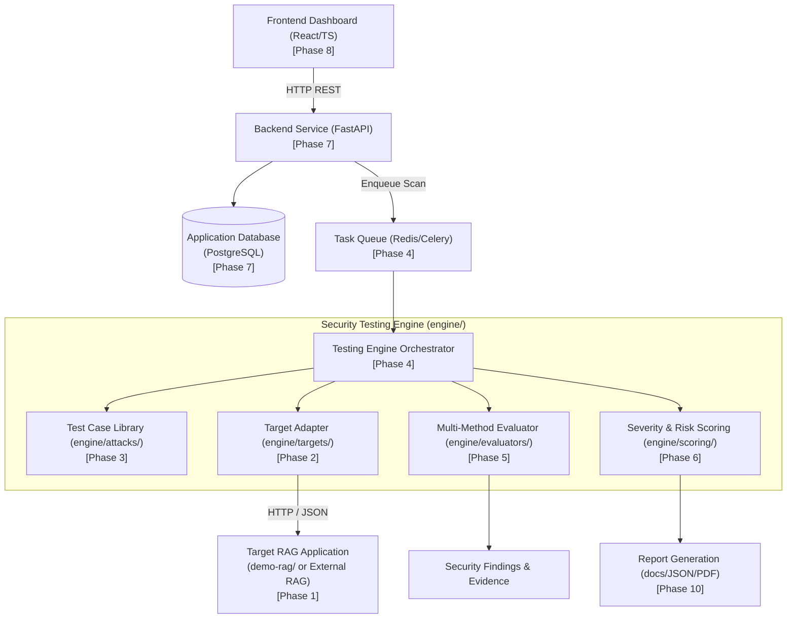

# RAGShield: System Architecture & Design

## 1. High-Level Modular Design

RAGShield enforces strict separation of concerns across four autonomous subsystems:

---

## 2. Component Responsibilities

### 1. `demo-rag/` (Target Application)
- **Role:** An isolated, local RAG application used as our safe testing ground.
- **Components:** Document ingestion, chunking, embedding generation, ChromaDB vector storage, and query answering.
- **Key Isolation Rule:** Vector storage for the target is strictly segregated from RAGShield's scan database.

### 2. `engine/` (Security Engine)
- **Role:** The core testing intelligence. Independent of the web UI and backend API.
- **`targets/`**: Standardized target interface. Decouples test execution from target implementation details.
- **`attacks/`**: Reproducible security test payloads organized by category.
- **`evaluators/`**: Evaluation logic checking whether a test passed, failed, or was inconclusive.
- **`scoring/`**: Converts confirmed failures into vulnerability findings with CVSS-style severity, confidence, and OWASP mapping.

### 3. `backend/` (Persistence & API)
- **Role:** Manages projects, scan configurations, schedules, scan runs, and persistent findings in PostgreSQL using SQLAlchemy and Alembic.

### 4. `frontend/` (Security Dashboard)
- **Role:** Web interface allowing security engineers to launch scans, monitor real-time progress, explore findings, and view remediation reports.

---

## 3. Security Boundary & Responsible Testing Rules

- **SSRF Defense:** Scan orchestrators strictly validate target URLs. Localhost, loopback (`127.0.0.1`), private RFC1918 subnets, and cloud metadata endpoints (`169.254.169.254`) are blocked unless an explicit `ALLOW_LOCAL_TARGETS=true` developer flag is set.
- **No Raw Credential Storage:** Target API keys or auth tokens are handled in memory or stored encrypted at rest.
- **Rate Limiting & Timeouts:** Built-in concurrency throttles protect targets from unintentional Denial of Service during security assessments.
