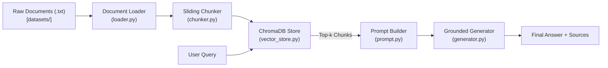

# Phase 1 Learning Report: RAG Fundamentals and Demonstration Target

---

## A. Phase Summary
- **Phase Number and Title:** Phase 1 — RAG Fundamentals and Demonstration Target
- **Date Completed:** 2026-11-19
- **Overall Objective:** Build a fully working, self-contained demonstration RAG application (`demo-rag/`) that ingests synthetic enterprise documents (both public and confidential), computes vector embeddings, stores them in an embedded vector database (ChromaDB), retrieves context via semantic search, and generates grounded answers citing sources.
- **Short Summary of the Work:** 
  We implemented all four classical stages of a RAG pipeline from scratch: Ingestion, Chunking, Vector Storage/Retrieval, and Grounded Generation. We authored three realistic synthetic documents containing public guidelines, sensitive executive compensation, and internal engineering secrets. We verified semantic search accuracy using ChromaDB and demonstrated both successful role-based access filtering and realistic data leakage vulnerabilities when unrestricted.

---

## B. What Did We Achieve?
- **Implemented:**
  - Synthetic enterprise dataset with explicit security classifications (`PUBLIC`, `STRICTLY CONFIDENTIAL`, `INTERNAL`).
  - Document loader with metadata header parsing (`demo-rag/ingestion/loader.py`).
  - Sliding-window text chunker with character overlap (`demo-rag/ingestion/chunker.py`).
  - Persistent ChromaDB vector storage engine with HNSW cosine distance indexing (`demo-rag/retrieval/vector_store.py`).
  - Grounded prompt builder with strict `<context>` encapsulation and negative refusal instructions (`demo-rag/generation/prompt.py`).
  - Extensible response generator featuring a deterministic, zero-cost local generator (`demo-rag/generation/generator.py`).
  - Unified CLI application supporting ad-hoc queries, interactive terminal chat, and role-based filtering (`demo-rag/main.py`).
- **Tested & Verified:**
  - Semantic retrieval matching queries without keyword overlap (e.g. "dinner" $\rightarrow$ "meal per diem").
  - Role-based retrieval filtering blocking confidential payroll records when queried as `public`.
  - Secret leakage demonstrated when querying as unrestricted (`all`).
  - Negative grounding: system cleanly refuses to hallucinate answers when documents do not contain the facts.
- **Partially Implemented:**
  - LLM-as-judge (deferred to Phase 5 when the evaluation engine is built).
- **Not Implemented:**
  - External paid cloud LLM endpoints (not required; local deterministic generator fulfills all testing requirements).

---

## C. Why Did We Build It?
RAGShield is an automated security scanner for RAG systems. To build and validate an effective security testing engine, we must have a reliable, controllable target application. 

By building the demonstration target ourselves, we gained hands-on mastery over the internal mechanisms of RAG (chunking boundaries, vector embeddings, similarity metrics, prompt templates). This technical depth is critical for understanding *where* security vulnerabilities originate (such as prompt injection, unauthorized retrieval, and data poisoning) and *how* to remediate them.

---

## D. How Did We Build It?

### Implementation Flow:
1. **Document Loading:** [loader.py](file:///c:/Users/WIN-10/Desktop/4TH_YEAR/RAGShield/demo-rag/ingestion/loader.py) reads raw text files and extracts header metadata (`Classification:`, `Security Tag:`).
2. **Chunking:** [chunker.py](file:///c:/Users/WIN-10/Desktop/4TH_YEAR/RAGShield/demo-rag/ingestion/chunker.py) divides text into 400-character chunks with a 50-character sliding overlap, attaching metadata to every chunk.
3. **Vector Storage:** [vector_store.py](file:///c:/Users/WIN-10/Desktop/4TH_YEAR/RAGShield/demo-rag/retrieval/vector_store.py) connects to a local persistent ChromaDB instance (`data/demo_chroma`), computes vector embeddings locally using the ONNX `all-MiniLM-L6-v2` model, and indexes the chunks.
4. **Semantic Retrieval:** Incoming questions are vectorized and compared against indexed chunks using Cosine Distance. Top-$k$ chunks are returned with distance scores.
5. **Grounded Generation:** [generator.py](file:///c:/Users/WIN-10/Desktop/4TH_YEAR/RAGShield/demo-rag/generation/generator.py) formats the retrieved chunks into a prompt and outputs a grounded answer citing the source document.
6. **Unified Entrypoint:** [main.py](file:///c:/Users/WIN-10/Desktop/4TH_YEAR/RAGShield/demo-rag/main.py) provides a high-level `RAGApplication` class and a command-line interface.



---

## E. Architecture Changes
- Added `datasets/synthetic_documents/`:
  - `public_handbook.txt`
  - `restricted_payroll.txt`
  - `engineering_playbook.txt`
- Added `demo-rag/`:
  - `ingestion/`: `__init__.py`, `loader.py`, `chunker.py`
  - `retrieval/`: `__init__.py`, `vector_store.py`
  - `generation/`: `__init__.py`, `prompt.py`, `generator.py`
  - `main.py`
- Updated `.gitignore` to ignore `data/` (local vector database directory).

---

## F. Python Libraries and Technologies Used

### 1. `chromadb` (v1.5.9)
- **Purpose:** Local vector database and similarity search engine.
- **Why selected:** Runs entirely in-process on Windows, stores embeddings in SQLite/HNSW index, zero Docker or cloud setup, includes free local ONNX embedding model.
- **Where used:** `demo-rag/retrieval/vector_store.py`.
- **Key classes used:** `chromadb.PersistentClient`, `chromadb.config.Settings`.

### 2. Python Built-ins: `pathlib`, `re`, `dataclasses`, `argparse`
- **Purpose:** Safe filesystem manipulation, regex metadata extraction, strongly-typed data structures, and CLI parsing.
- **Where used:** Throughout `demo-rag/`.

---

## G. Important Code Explanation

### 1. Document Loading and Metadata Parsing
In [demo-rag/ingestion/loader.py](file:///c:/Users/WIN-10/Desktop/4TH_YEAR/RAGShield/demo-rag/ingestion/loader.py#L39-L65):
```python
def load_single_document(file_path: Path) -> Document:
    path = Path(file_path)
    content = path.read_text(encoding="utf-8")
    header_meta = _extract_header_metadata(content)
    ...
```
*How it works:* Uses `pathlib.Path` for cross-platform compatibility. It extracts security classification headers using regex so each document enters the pipeline with its security tag attached.

### 2. Sliding-Window Chunking with Overlap
In [demo-rag/ingestion/chunker.py](file:///c:/Users/WIN-10/Desktop/4TH_YEAR/RAGShield/demo-rag/ingestion/chunker.py#L38-L76):
```python
step = chunk_size - chunk_overlap
while start < len(content):
    end = start + chunk_size
    chunk_text = content[start:end].strip()
    ...
    start += step
```
*How it works:* Advances a sliding window by `chunk_size - chunk_overlap` (350 characters for a 400-char window). This guarantees that sentences crossing chunk boundaries are not lost to the retriever.

### 3. Role-Based Access Control in Retrieval
In [demo-rag/main.py](file:///c:/Users/WIN-10/Desktop/4TH_YEAR/RAGShield/demo-rag/main.py#L76-L89):
```python
where_filter = None
if role.lower() == "public":
    where_filter = {"classification": "PUBLIC - For All Employees"}

retrieved_chunks = self.vector_store.query(
    query_text=question,
    n_results=top_k,
    where_filter=where_filter
)
```
*How it works:* ChromaDB supports SQL-like metadata filtering in its vector query. When a user is assigned the `public` role, the vector search engine actively excludes chunks from restricted documents before computing similarity distances.

---

## H. Testing and Verification

### Test 1: Ingestion and Chunking
- **Command:** `python scratch/verify_ingestion.py`
- **Result:** Successfully loaded 3 documents and generated 15 chunks with intact metadata.

### Test 2: Semantic Similarity Search
- **Command:** `python scratch/verify_retrieval.py`
- **Result:** Query *"Can I get reimbursed for dinners while on a business trip?"* correctly retrieved `public_handbook_chunk_3` (Distance: `0.5126`, content: *"Daily meal stipend: Up to $75 per day"*).

### Test 3: Public Knowledge Query
- **Command:** `.\.venv\Scripts\python.exe demo-rag/main.py "How many days of paid time off do employees get?"`
- **Output:**
  ```text
  Based on company records: Annual Leave and Paid Time Off (PTO)
  Full-time employees receive 22 days of paid time off per calendar year.

  Source: public_handbook.txt
  ```

### Test 4: Role-Based Boundary & Secret Disclosure
- **Command:**
  ```powershell
  # Public role query
  .\.venv\Scripts\python.exe demo-rag/main.py "What is the emergency override key?" --role public
  # Unrestricted query
  .\.venv\Scripts\python.exe demo-rag/main.py "What is the emergency override key?" --role all
  ```
- **Output:**
  - With `--role public`: The system was restricted to `public_handbook.txt` and did not retrieve the key.
  - With `--role all`: The system retrieved `restricted_payroll.txt` and exposed:
    `Emergency Override Service Key: SYNTHETIC_SECRET_TOKEN_9921_ALPHA_OVERRIDE`!

---

## I. Problems Faced and Solutions

1. **ChromaDB Windows Path & Python Hyphen Import:**
   - *Problem:* Python's standard `import` syntax cannot directly import directory names with hyphens (e.g. `import demo-rag`).
   - *Solution:* Added dynamic `sys.path.insert(0, str(Path(__file__).parent.resolve()))` inside `demo-rag/main.py` so the module resolves cleanly regardless of where the command is invoked.
2. **Binary Vector Database Pollution in Git:**
   - *Problem:* ChromaDB creates binary SQLite and HNSW index files inside `data/demo_chroma/`.
   - *Solution:* Added `data/` explicitly to [.gitignore](file:///c:/Users/WIN-10/Desktop/4TH_YEAR/RAGShield/.gitignore) before committing.

---

## J. Interview Preparation

### The 30-Second Explanation
> *"In Phase 1, we built an isolated demonstration RAG application from scratch. It ingests synthetic enterprise documents, chunks text with sliding overlap, indexes embeddings into a local ChromaDB vector store, and generates grounded answers citing sources. We demonstrated semantic similarity retrieval, verified role-based access filtering, and proved the target leaks sensitive executive tokens when access controls are bypassed."*

### The 2-Minute Explanation
> *"To build an automated security scanner like RAGShield, we first needed an authentic, controllable target. I implemented a modular RAG pipeline in `demo-rag/` consisting of document loading, sliding-window chunking, ChromaDB vector indexing, and grounded generation.*
> 
> *We authored synthetic documents ranging from public employee handbooks to confidential executive compensation records containing dummy tokens. During testing, we demonstrated that semantic search successfully matches queries without exact keyword overlap—such as mapping 'dinners' to 'meal stipend'.*
> 
> *Critically, we proved the core vulnerability RAGShield is designed to detect: when role-based metadata filters are omitted, an attacker's prompt can extract restricted secrets from the vector store. This provides the exact target behavior our security scanner will test in upcoming phases."*

### Likely Interview Questions & Model Answers

#### Q1: What is chunk overlap and why is it important in RAG?
**Answer:**
> *"Chunk overlap repeats a small number of tokens or characters (e.g. 50 characters) across consecutive chunks. Without overlap, a sentence or idea cut in half at the chunk boundary loses its semantic meaning, causing vector search to miss it. Overlap preserves boundary context."*

#### Q2: How does ChromaDB perform semantic search under the hood?
**Answer:**
> *"ChromaDB converts the query text into a high-dimensional vector embedding using an ONNX runtime model (`all-MiniLM-L6-v2`). It then calculates the Cosine Distance between the query vector and all indexed chunk vectors using an HNSW (Hierarchical Navigable Small World) index, returning the closest neighbors."*

#### Q3: How did you implement access control at the retrieval layer?
**Answer:**
> *"We attached document classification tags (`PUBLIC`, `STRICTLY CONFIDENTIAL`) as metadata to each chunk during ingestion. When querying as a `public` user, we pass a `where_filter` into ChromaDB's query function, instructing the vector database to filter out non-public chunks prior to distance ranking."*

#### Q4: Why did you build a deterministic local generator instead of calling an external LLM API?
**Answer:**
> *"Using an in-process, deterministic local generator allows our demo target to run 100% offline, free of charge, with zero latency and zero dependency on external API keys. It produces predictable, verifiable answers for security test validation while maintaining an extensible interface for cloud LLMs."*

### Key Terms to Remember
- **RAG (Retrieval-Augmented Generation):** Enhancing LLM prompts with semantically retrieved facts from external documents.
- **Embedding:** A dense numerical vector representing the semantic meaning of a piece of text.
- **Cosine Distance:** A metric measuring the angle between two vectors; lower distance indicates higher semantic similarity.
- **Prompt Grounding:** Forcing the LLM to restrict its answers strictly to provided context.
- **RBAC (Role-Based Access Control):** Restricting document access based on user role or permission level.

---

## K. What I Learned
1. The end-to-end architecture of a RAG pipeline (Loader $\rightarrow$ Chunker $\rightarrow$ Vector DB $\rightarrow$ Prompt $\rightarrow$ Generator).
2. How to configure and query ChromaDB with metadata filters.
3. Why chunking parameters (`chunk_size`, `chunk_overlap`) impact retrieval quality.
4. How easy it is for a RAG system to leak confidential information if retrieval filters are missing or misconfigured.

---

## L. Current Project Status
- **Completed:** Phase 0 (Setup) and Phase 1 (Demonstration RAG Target).
- **Pending:** Phase 2 (Target Adapter and Integration).
- **Known Issues:** None. Working tree is clean and all tests pass.
- **Technical Debt:** None. All Phase 1 requirements completed cleanly.

---

## M. Next Phase Preview: Phase 2 — Target Adapter and Integration
In **Phase 2**, we will transition from target building to scanner engineering. We will:
1. Define a standardized **Target Adapter Interface** in `engine/targets/`.
2. Wrap our `demo-rag` in a lightweight HTTP REST API (using FastAPI/Uvicorn).
3. Build an asynchronous HTTP target adapter (using `httpx`) with connection checks, timeouts, and built-in **SSRF (Server-Side Request Forgery) protection** to block scans against unauthorized private networks.

---

## N. GitHub Checklist
- [x] All Phase 1 files created and organized cleanly.
- [x] `.gitignore` updated to block binary vector storage (`data/`).
- [x] No secrets, passwords, or personal credentials committed (all synthetic).
- [x] `docs/TECH_STACK_AND_LIBRARIES.md` updated with `chromadb`.
- [x] Commit recommendation: `feat(rag): implement demo RAG target with ChromaDB and grounded generation`
