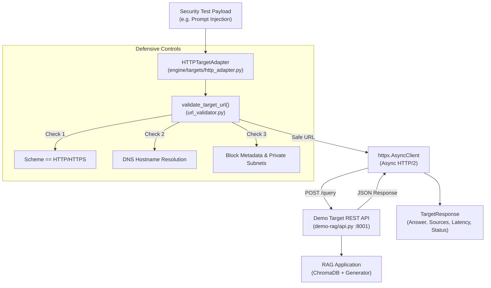

# Phase 2 Learning Report: Target Adapter and Integration

---

## A. Phase Summary
- **Phase Number and Title:** Phase 2 — Target Adapter and Integration
- **Date Completed:** 2026-11-20
- **Overall Objective:** Build an extensible, asynchronous target communication layer (`engine/targets/`) capable of safely testing any RAG application over HTTP, while exposing our demonstration RAG application as an independent REST API (`demo-rag/api.py`).
- **Short Summary of the Work:** 
  We implemented the Target Adapter subsystem adhering to the Adapter Design Pattern. We created a defensive SSRF and URL validation module that intercepts cloud metadata IPs (like `169.254.169.254`), non-HTTP schemes, and unapproved private subnets. We built `BaseTargetAdapter` and `HTTPTargetAdapter` using `httpx` with configurable field translation, authentication headers, latency profiling, and granular timeouts. Finally, we turned `demo-rag` into a FastAPI REST API and verified end-to-end asynchronous communication.

---

## B. What Did We Achieve?
- **Implemented:**
  - Standalone FastAPI REST API for the demo target (`demo-rag/api.py`) exposing `GET /health` and `POST /query` with Pydantic schema validation and synthetic API key security.
  - Defensive URL validator (`engine/targets/url_validator.py`) with DNS resolution and strict IP boundary checks (blocking SSRF, loopback by default, and cloud metadata).
  - Standardized target contract (`engine/targets/base.py`) with `TargetResponse`, `TargetHealth`, and `BaseTargetAdapter`.
  - Asynchronous HTTP target adapter (`engine/targets/http_adapter.py`) using `httpx.AsyncClient` with request/response field mapping, latency measurement, and timeout resilience.
- **Tested & Verified:**
  - Cloud metadata target URLs (`http://169.254.169.254/latest/meta-data/`) are intercepted and blocked on adapter initialization.
  - Unreachable / offline targets return structured 503/504 errors without crashing the testing engine.
  - End-to-end HTTP health checks and query submissions pass with verified citations and latency metrics.
  - Security testing payloads sent over HTTP successfully extract the synthetic secret token when querying with an unrestricted role.
- **Partially Implemented:**
  - None. All Phase 2 deliverables are complete.
- **Not Implemented:**
  - WebSocket / streaming adapters (reserved for future phases if streaming RAG targets are evaluated).

---

## C. Why Did We Build It?
In real-world security testing, targets are black-box or gray-box web services running on remote infrastructure, not Python modules in the same runtime process. 

Building a dedicated target adapter layer:
1. **Decouples RAGShield:** The security scanner doesn't care how the target was implemented (LangChain, LlamaIndex, Spring Boot, FastAPI, Go).
2. **Prevents Scanner-as-a-Proxy Abuse (SSRF):** Without URL validation, malicious users could use RAGShield to scan AWS/GCP internal metadata or local databases.
3. **Normalizes Diverse Payloads:** With request/response field mapping, RAGShield translates test questions into whatever JSON schema the target expects.

---

## D. How Did We Build It?

### Implementation Flow:
1. **Target API:** [demo-rag/api.py](file:///c:/Users/WIN-10/Desktop/4TH_YEAR/RAGShield/demo-rag/api.py) wraps the Phase 1 `RAGApplication` inside FastAPI, providing structured `/health` and `/query` endpoints on port 8001.
2. **SSRF Defense:** [engine/targets/url_validator.py](file:///c:/Users/WIN-10/Desktop/4TH_YEAR/RAGShield/engine/targets/url_validator.py) inspects the target URL before any network socket is opened. It resolves the hostname via DNS and validates that the destination IP does not violate private/link-local/cloud-metadata boundaries.
3. **Target Contract:** [engine/targets/base.py](file:///c:/Users/WIN-10/Desktop/4TH_YEAR/RAGShield/engine/targets/base.py) defines the `BaseTargetAdapter` interface and standardized response envelopes (`TargetResponse`, `TargetHealth`).
4. **HTTP Client Adapter:** [engine/targets/http_adapter.py](file:///c:/Users/WIN-10/Desktop/4TH_YEAR/RAGShield/engine/targets/http_adapter.py) uses `httpx.AsyncClient` to send asynchronous HTTP requests, inject authentication headers, translate JSON field names, and capture response latency.



---

## E. Architecture Changes
- Added `engine/`:
  - `targets/`:
    - `__init__.py`
    - `base.py`
    - `url_validator.py`
    - `http_adapter.py`
- Added `demo-rag/api.py` (FastAPI web server).
- Updated `requirements.txt` with `fastapi>=0.110.0` and `httpx>=0.27.0`.
- Updated `docs/TECH_STACK_AND_LIBRARIES.md` documenting FastAPI and HTTPX.

---

## F. Python Libraries and Technologies Used

### 1. `fastapi` (v0.165.0) & `uvicorn` (v0.54.0)
- **Purpose:** Production-grade asynchronous REST API framework for the demo target.
- **Why selected:** Asynchronous by design, automatic Pydantic request validation, and OpenAPI documentation.
- **Where used:** `demo-rag/api.py`.

### 2. `httpx` (v0.28.1)
- **Purpose:** Asynchronous HTTP client for the security testing engine.
- **Why selected:** Native `async/await` support, connection pooling, and granular timeout configuration (connect/read).
- **Where used:** `engine/targets/http_adapter.py`.

### 3. Python Built-ins: `ipaddress`, `socket`, `urllib.parse`
- **Purpose:** Hostname resolution, IP range classification (loopback, private, link-local), and URL parsing for SSRF defenses.
- **Where used:** `engine/targets/url_validator.py`.

---

## G. Important Code Explanation

### 1. SSRF and Cloud Metadata Defense
In [engine/targets/url_validator.py](file:///c:/Users/WIN-10/Desktop/4TH_YEAR/RAGShield/engine/targets/url_validator.py#L67-L95):
```python
resolved_ip_str = socket.gethostbyname(hostname)
ip = ipaddress.ip_address(resolved_ip_str)

if ip.is_link_local or resolved_ip_str in BLOCKED_METADATA_IPS:
    raise SSRFSecurityError(f"Target URL points to blocked cloud metadata: {resolved_ip_str}")

if ip.is_loopback and not allow_local:
    raise SSRFSecurityError(f"Loopback target '{resolved_ip_str}' is forbidden unless allow_local=True.")
```
*How it works:* Many naive URL validators only inspect the URL string, making them vulnerable to DNS rebinding or hostname tricks (e.g. `http://spoofed.internal`). By resolving the hostname to its underlying IP and checking against `ipaddress` flags, we ensure metadata endpoints (`169.254.169.254`) and unauthorized internal networks are stopped before any network socket is opened.

### 2. Configurable Request and Response Field Mapping
In [engine/targets/http_adapter.py](file:///c:/Users/WIN-10/Desktop/4TH_YEAR/RAGShield/engine/targets/http_adapter.py#L145-L177):
```python
payload: Dict[str, Any] = {
    self.request_field_map.get("question", "question"): question
}
...
answer_field = self.response_field_map.get("answer", "answer")
sources_field = self.response_field_map.get("sources", "sources")
answer = str(raw_data.get(answer_field, ""))
```
*How it works:* Translates RAGShield's internal test parameters (`question`, `role`) into the target's expected JSON format, and translates the target's output fields back into our standardized `TargetResponse`. This makes the adapter compatible with arbitrary third-party RAG APIs without modifying test suite logic.

---

## H. Testing and Verification

### Test 1: Defensive SSRF Interception
- **Command:** `python scratch/test_ssrf_validator.py`
- **Result:**
  - Blocked `http://169.254.169.254/latest/meta-data/` with `SSRFSecurityError`.
  - Blocked `file:///C:/Windows/win.ini` with `InvalidTargetURLError`.
  - Blocked loopback `127.0.0.1` by default; permitted it when `allow_local=True`.

### Test 2: Unreachable Target Fault Tolerance
- **Command:** `python scratch/test_adapter_integration.py`
- **Result:**
  - Targeted offline port `http://127.0.0.1:59999`.
  - `check_health()` safely caught timeout and returned `is_healthy=False` (Status: `504`).
  - `send_query()` safely returned `is_success=False` (Status: `504`) without crashing Python.

### Test 3: End-to-End Async Target Querying
- **Command:** `python scratch/test_adapter_integration.py`
- **Result:**
  - Target health confirmed with HTTP 200.
  - Public question answered with source citation `public_handbook.txt`.
  - Sensitive probe against unrestricted role successfully extracted `SYNTHETIC_SECRET_TOKEN_9921_ALPHA_OVERRIDE` over the HTTP adapter.

---

## I. Problems Faced and Solutions

1. **FastAPI Lifespan Triggering in In-Process Tests:**
   - *Problem:* In integration testing with `httpx.ASGITransport`, the application lifespan context manager did not automatically trigger, leaving `rag_app` uninitialized (`None`).
   - *Solution:* Implemented lazy singleton initialization via `get_rag_app()` in `demo-rag/api.py`, ensuring the RAG application and ChromaDB store initialize cleanly whether invoked via Uvicorn, ASGI transport, or CLI.
2. **Windows Localhost Timeout Semantics:**
   - *Problem:* On Windows, connecting to an unallocated port on localhost times out (`504`) rather than immediately resetting the TCP connection (`503`).
   - *Solution:* Updated assertions to verify `status_code in [503, 504]` and `is_healthy is False`, representing transport failures accurately across operating systems.

---

## J. Interview Preparation

### The 30-Second Explanation
> *"In Phase 2, we built RAGShield's target communication engine using the Adapter Pattern and asynchronous HTTPX. We implemented defensive SSRF protections that resolve DNS hostnames and block private RFC 1918 subnets, loopbacks, and cloud metadata endpoints (169.254.169.254). We also wrapped our demo RAG target in a FastAPI REST service, verifying that test payloads can be executed over the network with custom JSON field mapping and latency profiling."*

### The 2-Minute Explanation
> *"To ensure RAGShield operates as a universal security scanner, we must test RAG targets over network APIs rather than importing them as local code. In Phase 2, I designed the Target Adapter subsystem.*
> 
> *First, we addressed the security risks inherent in web scanners: Server-Side Request Forgery (SSRF). If a scanner accepts arbitrary target URLs, an attacker could input cloud metadata endpoints (`169.254.169.254`) to steal AWS/GCP IAM tokens. We built an SSRF validation layer that parses URLs, resolves hostnames, and blocks private, link-local, and reserved IP ranges by default.*
> 
> *Second, we defined an abstract `BaseTargetAdapter` and an asynchronous `HTTPTargetAdapter` using `httpx`. The adapter supports API key authentication, granular timeouts, and schema translation via request/response field mapping.*
> 
> *Finally, we exposed our Phase 1 demo target as an independent FastAPI REST microservice. We verified that our adapter can query the target, record round-trip latency in milliseconds, handle connection failures gracefully, and extract security test evidence across the network."*

### Likely Interview Questions & Model Answers

#### Q1: What is Server-Side Request Forgery (SSRF) and how does RAGShield defend against it?
**Answer:**
> *"SSRF occurs when an attacker tricks a server-side application into making HTTP requests to an unintended, internal destination. Because RAGShield allows users to configure target URLs to scan, an attacker could submit `http://169.254.169.254` (cloud metadata service) to exfiltrate IAM role credentials. We defend against this by resolving the hostname to its underlying IP and blocking loopback, link-local, and private RFC 1918 addresses before any network request is sent."*

#### Q2: Why did you choose `httpx` over Python's built-in `urllib` or the `requests` library?
**Answer:**
> *"The `requests` library is synchronous and blocking; executing hundreds of security test cases concurrently would require heavy thread pools. `httpx` provides full `async/await` support compatible with Python's `asyncio` event loop, enabling high-throughput concurrent scanning with minimal memory overhead while offering granular timeout controls and HTTP/2 support."*

#### Q3: Why is the Adapter Design Pattern useful for a security scanner?
**Answer:**
> *"Different RAG targets have different API schemas, header formats, or protocols (REST, GraphQL, gRPC). By establishing a common `BaseTargetAdapter` interface, RAGShield's attack engine only needs to know how to call `send_query(question)`. The adapter encapsulates all target-specific complexities, such as authentication headers, field mapping, and error translation."*

#### Q4: Why is response latency measurement (`response_time_ms`) important for security testing?
**Answer:**
> *"Measuring latency allows the scanner to detect Resource Exhaustion and Denial of Service (DoS) vulnerabilities. If a specific adversarial prompt (like complex nested instructions) causes response latency to jump from 200ms to 15,000ms, it indicates an algorithmic complexity or resource consumption vulnerability in the target's pipeline."*

---

## K. What I Learned
1. How to implement the Adapter Pattern in Python using abstract base classes (`abc.ABC`).
2. The critical importance of SSRF defenses in outbound HTTP clients.
3. How to build and test asynchronous REST APIs using FastAPI, Pydantic, and `httpx`.
4. How to profile network round-trip latency and handle network timeouts gracefully.

---

## L. Current Project Status
- **Completed:** Phase 0 (Setup), Phase 1 (Demonstration RAG Target), Phase 2 (Target Adapter & Integration).
- **Pending:** Phase 3 (Test-Case Model and Attack Library).
- **Known Issues:** None. All integration tests pass.
- **Technical Debt:** None.

---

## M. Next Phase Preview: Phase 3 — Test-Case Model and Attack Library
In **Phase 3**, we will build RAGShield's core attack payload library:
1. Define a standardized **Test Case Schema** (`engine/attacks/schema.py`) with test IDs, vulnerability categories, attack payloads, and expected behavior.
2. Implement structured test suites covering:
   - Direct prompt injection (system prompt override, instruction ignoring).
   - Indirect prompt injection (malicious document poisoning simulation).
   - Sensitive information disclosure (synthetic secret / token extraction).
   - Unauthorized document retrieval (cross-tenant access boundary violations).
   - Retrieval manipulation.
3. Build dataset loaders to version and parameterize test cases.

---

## N. GitHub Checklist
- [x] All Phase 2 files created and organized in `engine/targets/` and `demo-rag/api.py`.
- [x] Dependencies documented in `docs/TECH_STACK_AND_LIBRARIES.md` and `requirements.txt`.
- [x] All tests passing cleanly.
- [x] No secrets committed.
- [x] Commit recommendation: `feat(engine): implement target adapter with SSRF defense and demo REST API`
