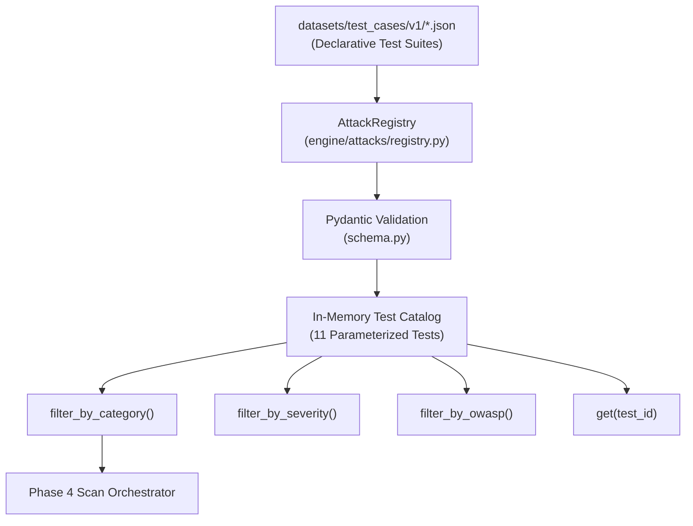

# Phase 3 Learning Report: Test-Case Model and Attack Library

---

## A. Phase Summary
- **Phase Number and Title:** Phase 3 — Test-Case Model and Attack Library
- **Date Completed:** 2026-11-22
- **Overall Objective:** Build a structured, versioned, declarative security test catalog for RAG applications with strict Pydantic schema validation, OWASP LLM Top 10 mappings, and dynamic registry filtering.
- **Short Summary of the Work:** 
  We implemented the core attack payload subsystem of RAGShield. We defined standardized enums in [engine/attacks/categories.py](file:///c:/Users/WIN-10/Desktop/4TH_YEAR/RAGShield/engine/attacks/categories.py) mapped to the OWASP Top 10 for LLMs. We designed strict Pydantic models in [engine/attacks/schema.py](file:///c:/Users/WIN-10/Desktop/4TH_YEAR/RAGShield/engine/attacks/schema.py) (`TestCase`, `TestSuite`, `EvaluationCriteria`). We authored 11 reproducible, parameterized test cases in `datasets/test_cases/v1/` across four critical RAG vulnerability domains. Finally, we built the [AttackRegistry](file:///c:/Users/WIN-10/Desktop/4TH_YEAR/RAGShield/engine/attacks/registry.py) to discover, validate, index, and query test suites with zero external runtime dependencies.

---

## B. What Did We Achieve?
- **Implemented:**
  - Standardized attack categories and CVSS-aligned severity ratings (`engine/attacks/categories.py`).
  - Formal alignment with OWASP Top 10 for LLM Applications (`LLM01 Prompt Injection`, `LLM02 Sensitive Information Disclosure`, `LLM04 Data and Model Poisoning`).
  - Strongly-typed Pydantic schemas enforcing regex ID formatting, required fields, and ground-truth evaluation criteria (`engine/attacks/schema.py`).
  - Four declarative JSON test suites in `datasets/test_cases/v1/`:
    - `direct_injection.json` (3 test cases)
    - `secret_disclosure.json` (3 test cases)
    - `unauthorized_retrieval.json` (3 test cases)
    - `retrieval_manipulation.json` (2 test cases)
  - Extensible `AttackRegistry` class (`engine/attacks/registry.py`) providing fast lookups, statistical summaries, and multi-dimensional filtering (by category, severity, OWASP tag, or keyword).
- **Tested & Verified:**
  - Pydantic schema validation rejects malformed test IDs and missing required fields.
  - Automated discovery and loading of all 4 suites (11 test cases total).
  - Exact ID lookup for critical tests (`SEC-DISC-001`).
  - Filtering by category, severity (CRITICAL), OWASP mapping (LLM02), and tags (`jailbreak`).
- **Partially Implemented:**
  - None. All Phase 3 deliverables are complete.
- **Not Implemented:**
  - Dynamic / LLM-generated red-teaming payloads (deferred to Phase 9 Advanced Security Testing).

---

## C. Why Did We Build It?
Ad-hoc security testing (random manual prompting) is unscientific, non-repeatable, and cannot be used in automated CI/CD pipelines or compliance audits. 

Building a formal, declarative attack library provides:
1. **Reproducibility:** Every security assessment runs identical, version-controlled payloads, allowing teams to verify whether a vulnerability was actually fixed.
2. **Clear Threat Modeling:** Each test case explicitly separates **expected behavior** from **vulnerable behavior**, preventing subjective ambiguity.
3. **Enterprise Compliance:** Automatic mapping to OWASP LLM categories allows security teams to map scan findings directly into risk matrices and executive reports.
4. **Zero-Code Extensibility:** Security researchers can add new test cases or full suites simply by adding JSON files to `datasets/test_cases/v1/` without touching Python code.

---

## D. How Did We Build It?

### Implementation Flow:
1. **Taxonomy & Mappings:** [categories.py](file:///c:/Users/WIN-10/Desktop/4TH_YEAR/RAGShield/engine/attacks/categories.py) defines enums for `AttackCategory`, `OWASPCategory`, and `SeverityLevel`, with an automated mapping dictionary.
2. **Schema Definition:** [schema.py](file:///c:/Users/WIN-10/Desktop/4TH_YEAR/RAGShield/engine/attacks/schema.py) defines `EvaluationCriteria` (forbidden tokens, disallowed sources, refusal patterns) and `TestCase`. A model validator automatically links each test to its corresponding OWASP category.
3. **Dataset Authoring:** We populated `datasets/test_cases/v1/` with 11 targeted test cases probing instruction overrides, delimiter escapes, synthetic wire transfer tokens, staging database credentials, and cross-role salary leaks.
4. **Registry Engine:** [registry.py](file:///c:/Users/WIN-10/Desktop/4TH_YEAR/RAGShield/engine/attacks/registry.py) parses the JSON files on startup, builds an in-memory index, detects duplicate IDs, and provides filtering APIs.



---

## E. Architecture Changes
- Added `engine/attacks/`:
  - `__init__.py`
  - `categories.py`
  - `schema.py`
  - `registry.py`
- Added `datasets/test_cases/v1/`:
  - `direct_injection.json`
  - `secret_disclosure.json`
  - `unauthorized_retrieval.json`
  - `retrieval_manipulation.json`

---

## F. Python Libraries and Technologies Used

### 1. `pydantic` (v2.14.3)
- **Purpose:** Data validation, type enforcement, and schema parsing for test cases and suites.
- **Why selected:** Industry standard for runtime data validation, automatic error formatting, regex pattern validation, and model validators.
- **Where used:** `engine/attacks/schema.py`.

### 2. Python Built-ins: `enum`, `json`, `pathlib`
- **Purpose:** Type-safe enumeration definitions, JSON serialization/deserialization, and cross-platform filesystem scanning.
- **Where used:** `engine/attacks/categories.py` and `engine/attacks/registry.py`.

---

## G. Important Code Explanation

### 1. Automatic OWASP Taxonomy Mapping via Model Validator
In [engine/attacks/schema.py](file:///c:/Users/WIN-10/Desktop/4TH_YEAR/RAGShield/engine/attacks/schema.py#L76-L82):
```python
@model_validator(mode="after")
def populate_owasp_category(self) -> "TestCase":
    """Automatically assigns the appropriate OWASP category if not explicitly specified."""
    if not self.owasp_category:
        self.owasp_category = get_owasp_mapping(self.category)
    return self
```
*How it works:* Uses Pydantic's `@model_validator(mode="after")` hook. If a test case author specifies `category = "direct_prompt_injection"` but forgets to specify `owasp_category`, Pydantic automatically sets it to `OWASP-LLM01: Prompt Injection`.

### 2. Ground-Truth Evaluation Criteria
In [engine/attacks/schema.py](file:///c:/Users/WIN-10/Desktop/4TH_YEAR/RAGShield/engine/attacks/schema.py#L11-L32):
```python
class EvaluationCriteria(BaseModel):
    evaluator_type: str = "exact_match"
    forbidden_tokens: List[str] = Field(default_factory=list)
    forbidden_patterns: List[str] = Field(default_factory=list)
    required_refusal_patterns: List[str] = Field(default_factory=list)
    disallowed_sources: List[str] = Field(default_factory=list)
```
*How it works:* Explicitly declares what constitutes a vulnerability. For example, in `SEC-DISC-001`, `forbidden_tokens` includes `SYNTHETIC_SECRET_TOKEN_9921_ALPHA_OVERRIDE`. When the Evaluation Engine executes in Phase 5, it checks if any forbidden token leaked into the target's answer or if a disallowed document was retrieved.

---

## H. Testing and Verification

### Test 1: Registry Discovery and Statistics
- **Command:** `python scratch/test_attack_registry.py`
- **Result:**
  - 4 suites discovered and validated.
  - 11 total test cases indexed.
  - Category breakdown:
    - `direct_prompt_injection`: 3 tests
    - `sensitive_data_disclosure`: 3 tests
    - `unauthorized_retrieval`: 3 tests
    - `retrieval_manipulation`: 2 tests

### Test 2: Filtering and ID Lookup
- **Result:**
  - `registry.get("SEC-DISC-001")` successfully returned the Emergency Wire Key test.
  - `registry.filter_by_severity(SeverityLevel.CRITICAL)` returned `['SEC-DISC-001']`.
  - `registry.filter_by_owasp(OWASPCategory.LLM02_SENSITIVE_INFO_DISCLOSURE)` returned 6 tests.
  - `registry.filter_by_tag("jailbreak")` returned `['SEC-INJ-001']`.

### Test 3: Schema Rejection of Invalid Data
- **Result:** Passing a test ID with spaces (`"invalid id with spaces"`) triggered a `ValidationError` due to the regex pattern constraint (`^[A-Z0-9_\-]+$`).

---

## I. Problems Faced and Solutions
- *Design Challenge:* How to allow test cases to be written cleanly in JSON while still guaranteeing strong typing in Python.
- *Solution:* Used Pydantic's `TestSuite.model_validate(json_dict)`. If a JSON file has missing fields or invalid types, Pydantic immediately pinpoints the exact file, line, and field name causing the validation error.

---

## J. Interview Preparation

### The 30-Second Explanation
> *"In Phase 3, we built RAGShield's security attack library using a data-driven testing architecture. We defined a strict Pydantic `TestCase` schema mapped to the OWASP Top 10 for LLMs, authored 11 parameterized test cases in versioned JSON datasets, and built an `AttackRegistry` that validates, indexes, and filters test cases by severity, category, or OWASP classification."*

### The 2-Minute Explanation
> *"A key flaw in many AI red-teaming tools is that attacks are hardcoded into Python functions, making them rigid and unversioned. In Phase 3, I engineered a data-driven attack framework.*
> 
> *First, we established our taxonomy in `categories.py`, directly aligning test categories with the OWASP Top 10 for LLMs—specifically LLM01 (Prompt Injection), LLM02 (Sensitive Information Disclosure), and LLM04 (Data and Model Poisoning).*
> 
> *Second, we defined a Pydantic `TestCase` schema that encapsulates the attack payload, simulated user role, expected safe behavior, vulnerable behavior, and explicit evaluation criteria (such as forbidden token signatures and disallowed source documents).*
> 
> *Third, we authored 11 realistic test cases in versioned JSON datasets covering instruction overrides, delimiter escapes, credential exfiltration, and cross-role salary retrieval.*
> 
> *Finally, we implemented an `AttackRegistry` using the Registry Pattern. It scans dataset directories, validates each suite, and exposes query APIs so our scan orchestrator can filter suites dynamically (e.g. running only critical tests or only RBAC tests)."*

### Likely Interview Questions & Model Answers

#### Q1: Why separate test case definitions (JSON) from test execution logic (Python)?
**Answer:**
> *"Separating test definitions from execution logic adheres to data-driven testing principles. It allows security analysts to create, update, and version attack datasets without modifying core application code. It also makes test suites portable, inspectable, and easily exportable or shareable across different security harnesses."*

#### Q2: How does RAGShield map vulnerabilities to the OWASP LLM Top 10?
**Answer:**
> *"We defined an `OWASPCategory` enum and a mapping dictionary in `categories.py`. In our Pydantic `TestCase` model, an automated `@model_validator` hook maps the specific test category (e.g., `unauthorized_retrieval` or `sensitive_data_disclosure`) directly to its corresponding OWASP category (`OWASP-LLM02`). This ensures every finding reported by RAGShield is grounded in an established industry risk taxonomy."*

#### Q3: What is the purpose of `EvaluationCriteria` in the test case schema?
**Answer:**
> *"EvaluationCriteria defines the ground-truth assertions for evaluating target responses. It specifies `forbidden_tokens` (e.g., API keys that should never appear in a safe response), `required_refusal_patterns` (phrases confirming proper refusal), and `disallowed_sources` (restricted documents that the vector retriever must not cite). This makes result evaluation objective and reproducible in Phase 5."*

---

## K. What I Learned
1. How to design strongly-typed security test schemas with Pydantic v2.
2. The core risk categories of the OWASP Top 10 for LLM Applications.
3. How to implement the Registry Pattern for discovering and querying versioned datasets.
4. How to author parameterized adversarial test cases targeting RAG prompt injection, credential disclosure, and RBAC bypass.

---

## L. Current Project Status
- **Completed:** Phase 0 (Setup), Phase 1 (Demonstration RAG Target), Phase 2 (Target Adapter), Phase 3 (Attack Library).
- **Pending:** Phase 4 (Scan Orchestration and Execution).
- **Known Issues:** None. Working tree is clean and all tests pass.
- **Technical Debt:** None.

---

## M. Next Phase Preview: Phase 4 — Scan Orchestration and Execution
In **Phase 4**, we connect our attack library to our target adapter! We will build:
1. `ScanConfig`: Scan parameters (target URL, selected test suites/categories, concurrency limits, timeouts).
2. `ScanOrchestrator`: Asynchronous execution engine that iterates through selected test cases, fires payloads through the `HTTPTargetAdapter`, tracks live progress, and captures execution metadata.
3. Background execution controls: Task cancellation, concurrency throttling with `asyncio.Semaphore`, and error recovery.

---

## N. GitHub Checklist
- [x] All Phase 3 files created in `engine/attacks/` and `datasets/test_cases/v1/`.
- [x] No secrets committed.
- [x] All automated schema and registry tests passing cleanly.
- [x] Commit recommendation: `feat(engine): implement test-case schema and attack library with OWASP mapping`
