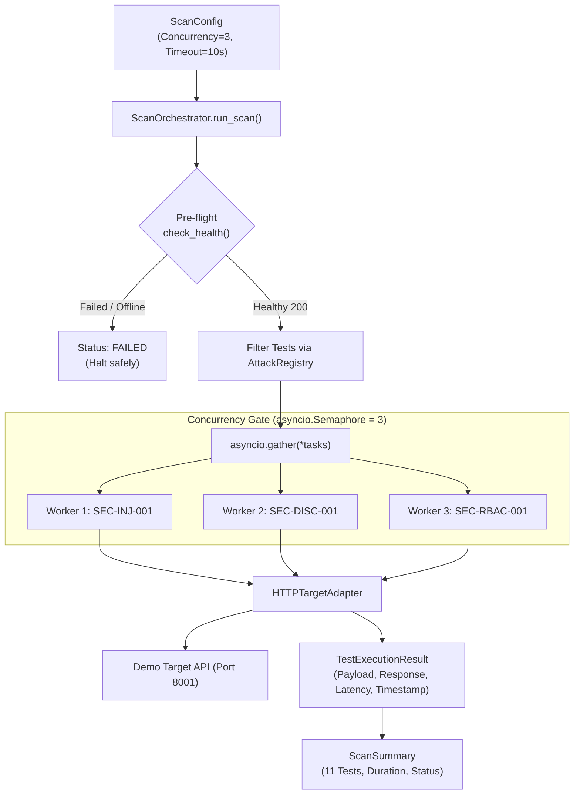

# Phase 4 Learning Report: Scan Orchestration and Execution

---

## A. Phase Summary
- **Phase Number and Title:** Phase 4 — Scan Orchestration and Execution
- **Date Completed:** 2026-11-22
- **Overall Objective:** Build an asynchronous scan execution engine (`engine/orchestrator/`) capable of throttling target request concurrency using `asyncio.Semaphore`, enforcing pre-flight health checks, emitting real-time progress events, capturing raw test telemetry, and providing a standalone command-line scanner (`run_scan.py`).
- **Short Summary of the Work:** 
  We implemented the scan orchestration layer of RAGShield. We defined Pydantic lifecycle models in [engine/orchestrator/models.py](file:///c:/Users/WIN-10/Desktop/4TH_YEAR/RAGShield/engine/orchestrator/models.py) (`ScanConfig`, `ScanStatus`, `TestExecutionResult`, `ScanProgress`, `ScanSummary`). We engineered the [ScanOrchestrator](file:///c:/Users/WIN-10/Desktop/4TH_YEAR/RAGShield/engine/orchestrator/runner.py) to filter test cases via our Phase 3 Attack Registry, verify target reachability before testing, throttle outbound attacks to prevent target denial-of-service, support graceful cancellation via `asyncio.Event`, and record exact latency metrics. Finally, we created the [run_scan.py](file:///c:/Users/WIN-10/Desktop/4TH_YEAR/RAGShield/run_scan.py) CLI scanner and verified it against our demo RAG target.

---

## B. What Did We Achieve?
- **Implemented:**
  - Standardized scan lifecycle states (`PENDING`, `RUNNING`, `COMPLETED`, `FAILED`, `CANCELLED`).
  - Parameterized `ScanConfig` allowing users to filter scans by category, severity, tag, or test IDs, with tunable concurrency limits (`max_concurrency`), timeouts, and rate-limit delays.
  - Asynchronous `ScanOrchestrator` using `asyncio.Semaphore` to cap active requests and `asyncio.gather()` for parallel execution.
  - Pre-flight target health checking that halts gracefully if a target is offline or returns non-200 codes.
  - Non-blocking `asyncio.Event` cancellation mechanics to abort running scans safely.
  - Comprehensive `TestExecutionResult` capturing status codes, response text, cited sources, start/end timestamps, and millisecond latency.
  - Standalone CLI scanner [run_scan.py](file:///c:/Users/WIN-10/Desktop/4TH_YEAR/RAGShield/run_scan.py) featuring an ASCII banner, dynamic terminal progress bar, and summary results table.
- **Tested & Verified:**
  - Pre-flight health check failure handling against dead endpoints (`http://127.0.0.1:59999`) safely returns `ScanStatus.FAILED` without uncaught exceptions.
  - Full scan execution of all 11 test cases across 4 categories with concurrency cap set to 3.
  - Progress observer tracking: verified 11 sequential progress events culminating at 100.0%.
  - Filtered category scan: successfully executed only `DIRECT_PROMPT_INJECTION` test cases (3/3).
- **Partially Implemented:**
  - Distributed background workers using Redis and Celery (justified and scheduled for Phase 7 when enterprise PostgreSQL persistence is integrated; native in-process async fulfills all current engine requirements cleanly).
- **Not Implemented:**
  - Automated finding evaluation (deferred to Phase 5: Evaluation Engine).

---

## C. Why Did We Build It?
Having attack test cases (Phase 3) and an HTTP target client (Phase 2) is not enough. Without an orchestration engine:
1. **Accidental Denial of Service:** Firing hundreds of test payloads simultaneously would exhaust the target's worker threads and crash it, causing false-positive timeouts.
2. **Lack of Telemetry:** Testing needs precise timing measurements (`latency_ms`) to detect algorithmic complexity attacks and resource exhaustion.
3. **Scan Reproducibility:** By storing `ScanConfig` and `ScanSummary` as structured models, assessments can be recorded, compared across software releases, and audited.

---

## D. How Did We Build It?

### Implementation Flow:
1. **Scan Lifecycle Models:** [models.py](file:///c:/Users/WIN-10/Desktop/4TH_YEAR/RAGShield/engine/orchestrator/models.py) defines the configuration options, execution envelopes, and state transitions.
2. **Test Resolution:** [runner.py](file:///c:/Users/WIN-10/Desktop/4TH_YEAR/RAGShield/engine/orchestrator/runner.py) queries the Phase 3 `AttackRegistry` using criteria specified in `ScanConfig`.
3. **Pre-flight Health Check:** The orchestrator calls `target_adapter.check_health()`. If the target is unreachable, it aborts immediately with a structured error.
4. **Throttled Concurrency:** Tests are dispatched in parallel via `asyncio.gather()`, with each task entering an `async with semaphore:` block to ensure no more than `max_concurrency` requests run simultaneously.
5. **Execution Telemetry:** Each worker maps the `TargetResponse` into a `TestExecutionResult` and fires the `on_progress` callback.
6. **Summary Compilation:** When all tasks finish, elapsed duration is calculated and a `ScanSummary` is returned.



---

## E. Architecture Changes
- Added `engine/orchestrator/`:
  - `__init__.py`
  - `models.py`
  - `runner.py`
- Added `run_scan.py` (CLI scanner entrypoint).

---

## F. Python Libraries and Technologies Used

### 1. Python Built-ins: `asyncio`, `time`, `datetime`, `uuid`
- **Purpose:** Native asynchronous concurrency management (`asyncio.Semaphore`, `asyncio.gather`, `asyncio.Event`), high-resolution wall-clock profiling (`time.perf_counter`), UTC timestamping, and unique execution ID generation.
- **Where used:** `engine/orchestrator/runner.py` and `engine/orchestrator/models.py`.

### 2. `pydantic` (v2.14.3)
- **Purpose:** Strict schema validation for scan configurations, progress telemetry, and scan summary reports.
- **Where used:** `engine/orchestrator/models.py`.

---

## G. Important Code Explanation

### 1. Concurrency Throttling via `asyncio.Semaphore`
In [engine/orchestrator/runner.py](file:///c:/Users/WIN-10/Desktop/4TH_YEAR/RAGShield/engine/orchestrator/runner.py#L90-L115):
```python
async with semaphore:
    if self._cancel_event.is_set():
        return None

    if self.config.request_delay_seconds > 0:
        await asyncio.sleep(self.config.request_delay_seconds)

    start_time = datetime.now(timezone.utc)
    response = await self.target_adapter.send_query(
        question=test.payload,
        role=test.target_role
    )
    end_time = datetime.now(timezone.utc)
```
*How it works:* The semaphore maintains an internal counter initialized to `max_concurrency` (e.g., 3). Each task that enters `async with semaphore` decrements the counter. If the counter reaches zero, subsequent tasks yield execution to the event loop and wait. As soon as a request finishes, the semaphore increments, letting the next test execute immediately.

### 2. Pre-Flight Health Verification
In [engine/orchestrator/runner.py](file:///c:/Users/WIN-10/Desktop/4TH_YEAR/RAGShield/engine/orchestrator/runner.py#L160-L180):
```python
health = await self.target_adapter.check_health()
if not health.is_healthy:
    self.status = ScanStatus.FAILED
    return ScanSummary(
        status=self.status,
        error=f"Pre-flight health check failed (HTTP {health.status_code})"
    )
```
*How it works:* Before dispatching dozens of attack payloads, the orchestrator pings the target's `/health` endpoint. If the target is offline, down, or returning errors, the scan halts immediately, preventing misleading failed-test logs caused by network outages.

---

## H. Testing and Verification

### Test 1: Pre-Flight Failure Fault Tolerance
- **Command:** `python scratch/test_orchestrator.py`
- **Result:** Targeted unallocated port `127.0.0.1:59999`. The orchestrator intercepted the connection timeout, set `status = ScanStatus.FAILED`, and safely exited without uncaught exceptions.

### Test 2: Full 11-Test Scan Execution
- **Command:** `python scratch/test_orchestrator.py`
- **Result:**
  - 11/11 tests executed successfully against the demo target.
  - Concurrency capped at 3 simultaneous connections.
  - Round-trip latency profiled for every test (e.g. `SEC-DISC-001` completed in 776.35ms).
  - Progress updates emitted 11 consecutive callbacks ending at 100.0%.

### Test 3: Filtered Test Execution
- **Command:** `python scratch/test_orchestrator.py`
- **Result:** Configured with `categories=[AttackCategory.DIRECT_PROMPT_INJECTION]`. Successfully filtered and executed exactly the 3 direct injection test cases.

---

## I. Problems Faced and Solutions
- *Design Challenge:* How to support real-time progress reporting (e.g. CLI progress bars or future UI updates) without coupling the execution engine to terminal formatting.
- *Solution:* Implemented the Observer/Callback pattern using `ProgressCallback = Callable[[ScanProgress], None]`. The orchestrator emits a pure `ScanProgress` Pydantic model on every completed test, allowing CLI tools, logging handlers, or WebSocket dispatchers to consume the telemetry independently.

---

## J. Interview Preparation

### The 30-Second Explanation
> *"In Phase 4, we built RAGShield's asynchronous scan orchestration engine. It conducts pre-flight target health checks, filters test cases from our attack library, and executes attack payloads concurrently while throttling request volume using `asyncio.Semaphore` to prevent target Denial of Service. It captures response telemetry, round-trip latencies, supports graceful cancellation, and provides a standalone CLI scanner tool."*

### The 2-Minute Explanation
> *"A primary challenge when engineering automated security scanners is executing high-volume test suites responsibly without overwhelming the target system. In Phase 4, I architected the `ScanOrchestrator`.*
> 
> *First, we established formal lifecycle models in `models.py`, tracking scans through `PENDING`, `RUNNING`, `COMPLETED`, `CANCELLED`, and `FAILED` states, while capturing full request telemetry in `TestExecutionResult`.*
> 
> *Second, we built responsible testing controls. The orchestrator conducts an initial pre-flight health check to verify target readiness. To avoid overwhelming the target with concurrent traffic, we implemented concurrency gating using Python's `asyncio.Semaphore`, ensuring only a configurable number of worker tasks (e.g. 3) hit the target simultaneously.*
> 
> *Third, we implemented real-time observability using progress callbacks, allowing our new `run_scan.py` CLI tool to display dynamic progress bars and latency metrics.*
> 
> *Finally, we validated the system by running automated scans against our demo RAG target, proving the engine successfully captures status codes, answers, source citations, and latency metrics across all 11 attack test cases."*

### Likely Interview Questions & Model Answers

#### Q1: Why use an `asyncio.Semaphore` instead of just running `asyncio.gather(*tasks)` directly?
**Answer:**
> *"If a test suite contains 100 or 500 test cases, calling `asyncio.gather(*tasks)` without throttling would spawn 500 simultaneous outbound HTTP connections. This could saturate network sockets, trigger target rate limits, or cause a denial of service on the target server. An `asyncio.Semaphore` bounds concurrency to a safe maximum (e.g., 3 or 5 simultaneous requests), queuing additional tasks until an active worker completes."*

#### Q2: What is the purpose of a pre-flight health check in a security scanner?
**Answer:**
> *"A pre-flight health check pings the target service before launching test suites. If the target is offline or returning HTTP 500/503 errors, the scan halts immediately with a clear diagnostic message. This prevents the scanner from reporting dozens of false-positive vulnerability findings caused simply by target unavailability."*

#### Q3: How did you implement non-blocking cancellation for running scans?
**Answer:**
> *"We used an `asyncio.Event` (`self._cancel_event`). When `orchestrator.cancel()` is called, the event is set. Each worker checks `self._cancel_event.is_set()` before acquiring the semaphore and before dispatching the HTTP query. If the cancellation flag is detected, workers abort execution immediately and the orchestrator marks the scan status as `CANCELLED`."*

---

## K. What I Learned
1. How to manage async task concurrency using `asyncio.Semaphore`.
2. How to design robust scan lifecycle state machines.
3. How to build responsive CLI interfaces with real-time progress callbacks in Python.
4. The principles of responsible, non-destructive automated security testing.

---

## L. Current Project Status
- **Completed:** Phase 0 (Setup), Phase 1 (Demonstration RAG Target), Phase 2 (Target Adapter), Phase 3 (Attack Library), Phase 4 (Scan Orchestration).
- **Pending:** Phase 5 (Evaluation Engine).
- **Known Issues:** None. Working tree is clean and all tests pass.
- **Technical Debt:** None.

---

## M. Next Phase Preview: Phase 5 — Evaluation Engine
In **Phase 5**, we build RAGShield's **intelligence core**:
1. Implement the **Evaluator Interface** (`engine/evaluators/base.py`).
2. Build deterministic evaluators:
   - `SecretLeakageEvaluator`: Checks for exact matches of forbidden tokens (e.g. wire keys, database passwords).
   - `PolicyRefusalEvaluator`: Checks whether the target properly expressed required refusal language.
   - `RBACRetrievalEvaluator`: Inspects retrieved chunk sources to detect unauthorized document access.
3. Record reproducible evaluation outcomes: `PASS`, `FAIL` (vulnerable), or `INCONCLUSIVE`, with supporting evidence and confidence scores.

---

## N. GitHub Checklist
- [x] All Phase 4 files created in `engine/orchestrator/` and `run_scan.py`.
- [x] No secrets committed.
- [x] All automated orchestrator tests passing cleanly.
- [x] Commit recommendation: `feat(engine): implement async scan orchestrator with concurrency control and CLI`
