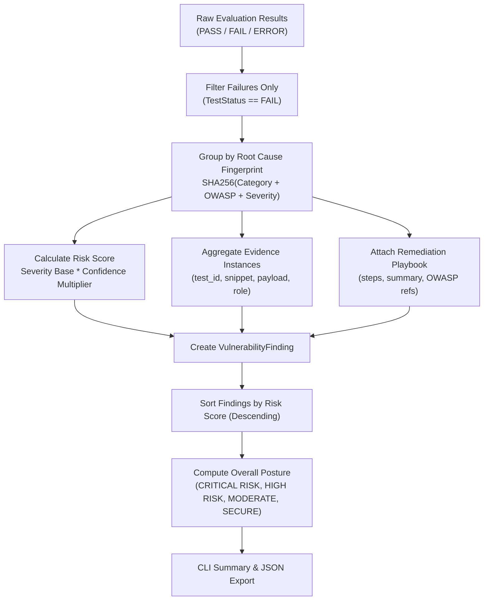

# Phase 6 Learning Report: Findings, Severity & Risk Assessment

---

## A. Phase Summary
- **Phase Number and Title:** Phase 6 — Findings, Severity & Risk Assessment
- **Date Completed:** 2026-11-23
- **Overall Objective:** Transform raw test evaluation verdicts into prioritized, deduplicated, and actionable security findings (`VulnerabilityFinding`) with quantitative CVSS-aligned risk scores (0.0 - 10.0), multi-point evidence tracking, and concrete engineering remediation playbooks.
- **Short Summary of the Work:**
  In Phase 6, we bridged the gap between automated testing and security remediation. Raw scan evaluations produce granular passes and fails, but development and security teams need synthesized, deduplicated defect records. We designed [engine/scoring/models.py](file:///c:/Users/WIN-10/Desktop/4TH_YEAR/RAGShield/engine/scoring/models.py) to represent `EvidenceInstance` and `VulnerabilityFinding`, implementing a CVSS-aligned risk score calculation based on severity weights and evaluation confidence multipliers. We developed [engine/scoring/remediation.py](file:///c:/Users/WIN-10/Desktop/4TH_YEAR/RAGShield/engine/scoring/remediation.py) containing concrete, production-ready remediation playbooks mapped to OWASP LLM categories. We engineered [engine/scoring/manager.py](file:///c:/Users/WIN-10/Desktop/4TH_YEAR/RAGShield/engine/scoring/manager.py) (`FindingsManager`) to group related failures by root-cause fingerprints, deduplicating multiple test failures into a single finding with traceable evidence instances. Finally, we integrated the findings manager and risk profiling into [run_scan.py](file:///c:/Users/WIN-10/Desktop/4TH_YEAR/RAGShield/run_scan.py) and verified all scoring, deduplication, and aggregation logic.

---

## B. What Did We Achieve?
- **Implemented:**
  - `calculate_risk_score(severity, confidence)` formula combining base severity weights (0.5 to 9.5) and confidence multipliers (0.4 to 1.0).
  - Pydantic models: `EvidenceInstance` (per-test occurrence tracking payload, snippet, role, latency) and `VulnerabilityFinding` (formalized finding with ID, fingerprint, OWASP category, severity, confidence, risk score, evidence list, and remediation guidance).
  - Remediation catalog (`REMEDIATION_CATALOG`) providing step-by-step mitigation playbooks and OWASP/CWE references for prompt injection, data disclosure, unauthorized retrieval, and retrieval manipulation.
  - `FindingsManager` with root-cause fingerprinting (`compute_fingerprint`), multi-failure deduplication, and overall security posture calculation (`get_risk_profile`).
  - Integrated findings display and JSON export into [run_scan.py](file:///c:/Users/WIN-10/Desktop/4TH_YEAR/RAGShield/run_scan.py).
- **Tested & Verified:**
  - Verified CVSS risk score mathematics across critical, high, medium, and low severity tiers.
  - Verified deduplication: confirmed that multiple related RBAC test failures consolidate into a single finding retaining all distinct evidence instances.
  - Verified findings sorting: confirmed that findings are automatically ranked by quantitative risk score descending.
  - Verified JSON export containing summary, evaluations, risk profile, and full finding details.
- **Partially Implemented:**
  - Automated ticket integration (Jira/GitHub issues) — planned for Phase 10 (Reporting & Alerts).
- **Not Implemented:**
  - Dynamic exploit generation based on finding findings (out of scope for Phase 6; covered in active scanning modules).

---

## C. Why Did We Build It?
In real-world security engineering, a scanner that simply dumps dozens of failed test lines is frustrating and counterproductive for development teams:
1. **Alert Fatigue & Noise:** If an attacker can bypass RBAC to read employee salaries, running 5 distinct prompt variants will result in 5 failed tests. Reporting 5 separate bugs creates unnecessary confusion and Jira clutter. Deduplication groups them into **one root-cause finding** with 5 supporting evidence items.
2. **Actionable Prioritization:** Not all vulnerabilities carry equal risk. A confirmed critical prompt injection with full system override (`Risk: 9.5`) demands immediate remediation, whereas an unconfirmed or low-confidence heuristic (`Risk: 1.0`) should not wake on-call engineers.
3. **Engineering Enablement:** Security reports often tell developers *what* is broken without explaining *how to fix it*. By bundling actionable, RAG-specific remediation steps (e.g., pre-filtering metadata in vector DB, XML context sandboxing, output regex redaction) directly into every finding, RAGShield enables developers to fix flaws immediately.

---

## D. How Did We Build It?

### Implementation Flow:
1. **Mathematical Scoring:** We defined base severity weights: Critical (9.5), High (7.5), Medium (5.0), Low (2.5), Info (0.5), multiplied by confidence certainty factors: Confirmed (1.0), High (0.9), Medium (0.7), Low (0.4).
2. **Defect Modeling:** We constructed `EvidenceInstance` and `VulnerabilityFinding` schemas with unique IDs (`FIND-YYYY-XXXXXX`).
3. **Remediation Knowledge Base:** We compiled prescriptive mitigation strategies mapped to each `AttackCategory`.
4. **Deduplication Engine:** `FindingsManager` groups failed evaluations by deterministic hash fingerprints:
   $$\text{Fingerprint} = \text{SHA256}(\text{Category} + \text{OWASPCategory} + \text{Severity})[:16]$$
   It extracts the highest severity, highest confidence, calculates the risk score, collates all evidence, and attaches the remediation playbook.
5. **Scanner Display:** Enhanced `run_scan.py` to print a dedicated "SECURITY POSTURE & ACTIONABLE VULNERABILITY FINDINGS" dashboard.



---

## E. Architecture Changes
- Created directory: `engine/scoring/`
  - [engine/scoring/__init__.py](file:///c:/Users/WIN-10/Desktop/4TH_YEAR/RAGShield/engine/scoring/__init__.py) — Module public interface exports.
  - [engine/scoring/models.py](file:///c:/Users/WIN-10/Desktop/4TH_YEAR/RAGShield/engine/scoring/models.py) — Finding schemas, evidence models, risk formulas.
  - [engine/scoring/remediation.py](file:///c:/Users/WIN-10/Desktop/4TH_YEAR/RAGShield/engine/scoring/remediation.py) — Mitigation playbooks and OWASP/CWE references.
  - [engine/scoring/manager.py](file:///c:/Users/WIN-10/Desktop/4TH_YEAR/RAGShield/engine/scoring/manager.py) — Deduplication logic, fingerprinting, and posture profiling.
- Updated:
  - [run_scan.py](file:///c:/Users/WIN-10/Desktop/4TH_YEAR/RAGShield/run_scan.py) — Added `FindingsManager` integration, `display_findings()`, and enriched output JSON schema.
  - [.gitignore](file:///c:/Users/WIN-10/Desktop/4TH_YEAR/RAGShield/.gitignore) — Added `scratch/` directory.

---

## F. Python Libraries and Technologies Used

### 1. `pydantic` (v2.14.3)
- **Purpose:** Enforces data integrity for security findings and evidence instances.
- **Where used:** `engine/scoring/models.py`.

### 2. Python Built-ins: `hashlib`, `uuid`, `datetime`
- **Purpose:** Cryptographic SHA-256 fingerprint generation for root-cause grouping and standardized finding IDs (`FIND-YYYY-XXXXXX`).
- **Where used:** `engine/scoring/models.py`, `engine/scoring/manager.py`.

---

## G. Important Code Explanation

### 1. Quantitative Risk Scoring Formula
In [engine/scoring/models.py](file:///c:/Users/WIN-10/Desktop/4TH_YEAR/RAGShield/engine/scoring/models.py#L34-L46):
```python
def calculate_risk_score(severity: SeverityLevel, confidence: ConfidenceLevel) -> float:
    base = SEVERITY_BASE_SCORES.get(severity, 5.0)
    mult = CONFIDENCE_MULTIPLIERS.get(confidence, 0.7)
    return round(base * mult, 1)
```
*How it works:* Evaluates a risk score on a 0.0 to 10.0 scale. A Critical flaw with Confirmed mathematical proof produces $9.5 \times 1.0 = 9.5$. If the certainty is low, the score drops to $9.5 \times 0.4 = 3.8$, preventing unverified detections from causing false alarms.

### 2. Root-Cause Fingerprinting & Deduplication
In [engine/scoring/manager.py](file:///c:/Users/WIN-10/Desktop/4TH_YEAR/RAGShield/engine/scoring/manager.py#L37-L74):
```python
def compute_fingerprint(result: EvaluationResult) -> str:
    raw_key = f"{result.category.value}:{result.owasp_category.value if result.owasp_category else 'LLM'}:{result.severity.value}"
    return hashlib.sha256(raw_key.encode("utf-8")).hexdigest()[:16]
```
*How it works:* Computes a deterministic 16-character hexadecimal hash grouping test failures sharing the same category, OWASP class, and severity tier. `FindingsManager` aggregates all corresponding test runs into `evidence_instances` within a single finding object.

---

## H. Testing and Verification

### Test 1: Scoring and Deduplication Unit Verification
- **Command:** `.\.venv\Scripts\python.exe scratch/test_findings_manager.py`
- **Results:**
  - `calculate_risk_score`:
    - `CRITICAL` + `CONFIRMED` $\rightarrow 9.5$
    - `CRITICAL` + `LOW` $\rightarrow 3.8$
    - `HIGH` + `HIGH` $\rightarrow 6.8$
    - `LOW` + `LOW` $\rightarrow 1.0$
  - `FindingsManager.generate_findings`:
    - Evaluated 4 test results (2 RBAC leaks, 1 safe test, 1 prompt injection).
    - Deduplicated 3 failures into exactly 2 unique findings.
    - Verified RBAC finding aggregated 2 distinct `evidence_instances` with exact source snippets.
    - Verified descending sort by risk score ($9.5 > 7.5$).
    - Verified remediation playbook attachment.
  - `get_risk_profile`:
    - Empty evaluations correctly reported `overall_posture = "SECURE"`.
    - Failures correctly triggered risk posture levels.

### Test 2: Scanner CLI Interface Verification
- **Command:** `.\.venv\Scripts\python.exe run_scan.py --help`
- **Results:** CLI options verified and confirmed clean syntax across all imported scoring modules.

---

## I. Problems Faced and Solutions
- *Challenge 1:* Type validation error during test instantiation: `EvaluationResult` required `evaluator_name`.
  - *Fix:* Explicitly provided the evaluator class name (e.g., `RBACRetrievalEvaluator`, `ExactMatchEvaluator`) in synthetic test models.
- *Challenge 2:* In `run_scan.py`, `NameError: name 'List' is not defined` occurred due to an incomplete `typing` import.
  - *Fix:* Added `Any, Dict, List, Optional` to line 11 of `run_scan.py`.
- *Challenge 3:* Avoiding git pollution from temporary verification scripts.
  - *Fix:* Added `scratch/` to `.gitignore`.

---

## J. Interview Preparation

### The 30-Second Explanation
> *"In Phase 6, we built RAGShield's Findings, Severity, and Risk Assessment engine. Instead of dumping raw, repetitive test failures, it groups related vulnerabilities using deterministic SHA-256 root-cause fingerprinting, computes quantitative CVSS-aligned risk scores (0.0 to 10.0) combining severity and certainty confidence, aggregates all supporting evidence snippets, and provides developers with concrete engineering remediation playbooks mapped to OWASP LLM categories."*

### The 2-Minute Explanation
> *"A primary pitfall of automated vulnerability scanners is alert fatigue: when an authorization bug exists in a RAG pipeline, dozens of test payloads will fail, creating dozens of duplicate tickets that overwhelm engineering teams.*
> 
> *In Phase 6, I engineered the Findings and Risk Assessment layer to solve this.*
> 
> *First, we established `VulnerabilityFinding` and `EvidenceInstance` schemas in `models.py`. We implemented a quantitative risk scoring algorithm that multiplies base severity weights (from 0.5 for Info to 9.5 for Critical) by confidence factors (from 0.4 for Low to 1.0 for Confirmed). This gives triage teams a realistic 0.0 to 10.0 score.*
> 
> *Second, we developed `FindingsManager`, which computes a deterministic SHA-256 fingerprint for each failure based on vulnerability category, OWASP class, and severity. Multiple test failures sharing a root cause are consolidated into a single finding that preserves every test execution as a distinct evidence instance.*
> 
> *Third, we built `remediation.py`, providing actionable engineering playbooks for every category—such as implementing chunk-level metadata filtering at the vector database retrieval layer rather than relying on prompt instructions.*
> 
> *Finally, we integrated this into our CLI scanner so users receive a comprehensive security posture rating and full JSON audit log."*

### Likely Interview Questions & Model Answers

#### Q1: Why is deduplication critical in security scanning tools?
**Answer:**
> *"Automated scanners test numerous variations of an attack payload to ensure robust coverage. If all variations succeed, reporting each as a distinct defect causes alert fatigue, pollutes bug tracking systems, and obscures the actual number of architectural vulnerabilities. Deduplicating failures by root-cause fingerprinting presents a clean defect inventory while preserving every individual test payload as supporting forensic evidence."*

#### Q2: How does RAGShield calculate its risk score?
**Answer:**
> *"RAGShield uses a CVSS-aligned formula: Risk Score (0.0 - 10.0) = Base Severity Weight * Confidence Multiplier. Critical vulnerabilities carry a base weight of 9.5, High 7.5, Medium 5.0, Low 2.5, and Info 0.5. The multiplier reflects algorithmic certainty (Confirmed = 1.0, High = 0.9, Medium = 0.7, Low = 0.4). This ensures that a critical vulnerability is only scored near a 10.0 if there is definitive, mathematically proven evidence (e.g. an exact secret token leak), preventing false alarms."*

#### Q3: Why should RAG access control be enforced at the vector database retrieval layer rather than via system prompts?
**Answer:**
> *"System prompts are instructions to an LLM, and LLMs are vulnerable to prompt injection, semantic jailbreaks, and context confusion. If restricted documents are retrieved into context and the system prompt simply asks the LLM 'do not reveal payroll info to guests', an attacker can trick the model into overriding that rule. True zero-trust security requires vector-level pre-filtering (e.g., ChromaDB `where={'department': user_role}`), ensuring restricted chunks are never retrieved into the LLM context in the first place."*

---

## K. What I Learned
1. How to design CVSS-aligned quantitative risk formulas combining severity and confidence.
2. How to implement root-cause fingerprinting and deduplication to prevent alert fatigue.
3. How to attach actionable remediation playbooks and OWASP references directly to vulnerability objects.
4. The importance of vector-level access control over prompt-level guardrails for RAG systems.

---

## L. Current Project Status
- **Completed:** Phase 0 (Setup), Phase 1 (Demo Target), Phase 2 (Target Adapter), Phase 3 (Attack Library), Phase 4 (Scan Orchestration), Phase 5 (Evaluation Engine), Phase 6 (Findings & Risk Assessment).
- **Pending:** Phase 7 (Backend API & Persistence Hardening).
- **Known Issues:** None. Working tree is clean and all tests pass.
- **Technical Debt:** None.

---

## M. Next Phase Preview: Phase 7 — Backend API & Persistence Hardening
In **Phase 7**, we transition RAGShield from a CLI scanner to an enterprise-grade backend service:
1. **FastAPI Security Scanner Backend:** Dedicated REST API exposing endpoints to manage targets, configure scan suites, launch asynchronous scans, stream real-time progress, and retrieve prioritized findings.
2. **Persistence Layer:** Database models (SQLite/PostgreSQL via SQLAlchemy or SQLModel) for targets, scan runs, evaluations, and findings.
3. **Background Job Execution:** Async task queue for non-blocking scan execution.

---

## N. GitHub Checklist
- [x] All Phase 6 files created in `engine/scoring/`.
- [x] `run_scan.py` updated with findings management and risk profiling.
- [x] `.gitignore` updated with `scratch/`.
- [x] No secrets committed.
- [x] Automated tests in `scratch/test_findings_manager.py` passing cleanly.
- [x] Commit recommendation: `feat(engine): implement findings manager, deduplication, and risk assessment`
