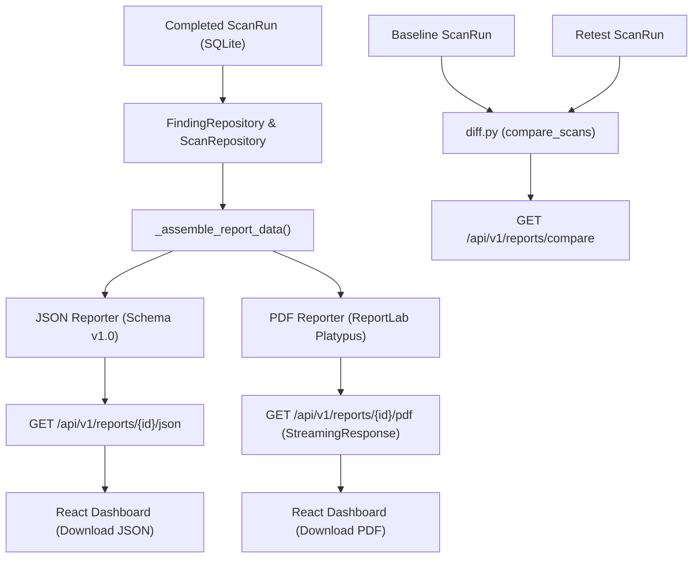

# Phase 10: Reports and Regression Testing

---

## A. Phase Summary
- **Phase Number:** Phase 10
- **Title:** Reports and Regression Testing
- **Date Completed:** 2026-11-24
- **Overall Objective:** Build production-grade reporting engines (machine-readable JSON and publication-quality PDF) for security assessments, a deterministic scan comparison diffing engine to track vulnerability lifecycles across retests, and automated CI/CD regression gates to block unsafe builds.
- **Short Summary:**
  In Phase 10, RAGShield was transformed from a real-time scanner into a complete enterprise compliance and regression-testing platform. We engineered the JSON audit report generator (`engine/reporting/json_reporter.py`) adhering to the RAGShield Audit Report Schema v1.0, and an executive PDF generator (`engine/reporting/pdf_reporter.py`) built with ReportLab's Platypus flowable engine featuring dynamic multi-pass pagination (`Page X of Y`), quantitative CVSS posture scorecards, and OWASP compliance matrices. Furthermore, we built a mathematical set-based scan comparison engine (`engine/reporting/diff.py`) that deterministically tracks resolved (`FIXED`), persisting (`RECURRING`), and regressed (`NEW`) defects between baseline and remediation scans. We exposed these capabilities through new REST API endpoints (`/api/v1/reports/{scan_id}/json`, `/pdf`, and `/compare`), integrated one-click export buttons into the React dashboard (`FindingViewer.jsx`), and added `--json`, `--pdf`, and `--fail-on-severity` CLI flags to `run_scan.py` for CI/CD pipeline automation.

---

## B. What Did We Achieve?

### 1. Implemented & Verified Capabilities
- **Standardized JSON Audit Report Generator (`engine/reporting/json_reporter.py`):**
  - Serializes full scan telemetry, target metadata, executive posture, severity distribution, OWASP LLM Top 10 compliance statuses, deduplicated findings, forensic evidence snippets, and actionable remediation steps into a structured, machine-readable JSON document.
- **Executive PDF Report Generator (`engine/reporting/pdf_reporter.py`):**
  - Programmatically generates publication-quality multi-page PDF audit reports using ReportLab.
  - Implemented `NumberedCanvas` two-pass rendering for dynamic total page counting and page headers/footers.
  - Styled with enterprise palette: color-coded severity badges (Critical=Red, High=Amber, Medium=Yellow, Low=Blue), quantitative posture gauge (0.0 to 10.0), and green/red OWASP compliance statuses.
  - Formats technical remediation playbooks with engineering action steps and external security references.
- **Scan Regression Diffing Engine (`engine/reporting/diff.py`):**
  - Compares any two scans for a target using deterministic finding fingerprints (`category:owasp:severity`).
  - Automatically classifies findings into:
    - `FIXED`: Defect was present in the baseline scan but absent in the remediation retest (vulnerability eliminated).
    - `RECURRING`: Defect is present in both scans (patch failed or was incomplete).
    - `NEW`: Defect was absent in the baseline but present in the remediation scan (security regression introduced).
  - Computes quantitative risk delta (`remediation_max_risk - baseline_max_risk`) and posture transitions (e.g. `CRITICAL RISK ➔ HIGH RISK`).
- **CI/CD Security Gate CLI Flag (`run_scan.py`):**
  - Added `--fail-on-severity <CRITICAL|HIGH|MEDIUM|LOW>` flag.
  - Returns POSIX exit code `1` if any finding meets or exceeds the severity threshold, and exit code `0` if clean.
  - Added `--json <path>` and `--pdf <path>` flags to automatically compile audit artifacts upon scan completion.
- **REST API Endpoints (`backend/app/api/v1/reports.py`):**
  - `GET /api/v1/reports/{scan_id}/json`: Returns structured JSON audit payload.
  - `GET /api/v1/reports/{scan_id}/pdf`: Streams binary PDF attachment (`application/pdf`) with `Content-Disposition`.
  - `GET /api/v1/reports/compare?base_scan_id=...&remediation_scan_id=...`: Computes and returns JSON regression diff.
- **Frontend One-Click Export (`frontend/src/components/FindingViewer.jsx`):**
  - Added "Export JSON" and "Download PDF" action buttons directly in the dashboard header.
  - Auto-triggers file downloads in the browser with custom filenames (`RAGShield_Audit_<scan_id>.pdf`).

### 2. Partially Implemented / Deferred to Next Phases
- **Automated GitHub Actions CI/CD Workflow (`.github/workflows/ci.yml`):** The CLI gate flag `--fail-on-severity` is fully functional and verified; the automated YAML pipeline execution is scheduled for Phase 11.
- **Containerized Microservices:** Running via local virtual environment; Docker containerization is scheduled for Phase 11.

---

## C. Why Did We Build It?
1. **Closing the DevSecOps Feedback Loop:** Discovering vulnerabilities on a screen is meaningless unless security engineers can hand formal compliance reports to engineering managers, auditors, and CISOs.
2. **Preventing Security Regressions:** When AI engineers patch prompt injection or add guardrails, they frequently introduce regressions (e.g. over-blocking legitimate users or causing context window DoS). The diffing engine quantitatively proves whether a fix worked without introducing new vulnerabilities.
3. **Automated Pipeline Enforcement:** Security scans should not require manual operator intervention. By providing an exit code gate (`--fail-on-severity HIGH`), RAGShield can be plugged into any standard CI/CD pipeline (Jenkins, GitLab CI, GitHub Actions) to automatically fail a build if high-risk vulnerabilities are detected.

---

## D. How Did We Build It?

### 1. Step-by-Step Implementation Flow
1. **Reporting Architecture (`engine/reporting/`):**
   - Created `json_reporter.py` to assemble normalized audit data structures.
   - Built an OWASP coverage calculation function that groups probe evaluations by OWASP category and determines compliance status (`COMPLIANT` vs `DEFICIENT`).
2. **ReportLab Flowable Story Pipeline (`pdf_reporter.py`):**
   - Constructed a custom two-pass canvas (`NumberedCanvas`) that intercepts `showPage()` calls to dynamically compute total pages and draw running headers/footers with timestamps and page numbers.
   - Built a flowable story sequence (`SimpleDocTemplate`) containing Title, Metadata Table, Executive Posture Banner, OWASP Matrix Table, and deduplicated findings.
   - Wrapped individual finding blocks inside `KeepTogether` objects to prevent awkward page splits across evidence snippets and remediation steps.
3. **Set-Based Diffing Algorithm (`diff.py`):**
   - Mapped baseline findings and remediation findings into dictionaries indexed by their deterministic `fingerprint`.
   - Evaluated the set union of all fingerprints:
     $$\text{All Fingerprints} = \mathcal{F}_{\text{base}} \cup \mathcal{F}_{\text{rem}}$$
   - Assigned each item to `FIXED`, `RECURRING`, or `NEW` based on set membership:
     - $fp \in \mathcal{F}_{\text{base}} \land fp \notin \mathcal{F}_{\text{rem}} \implies \text{FIXED}$
     - $fp \in \mathcal{F}_{\text{base}} \land fp \in \mathcal{F}_{\text{rem}} \implies \text{RECURRING}$
     - $fp \notin \mathcal{F}_{\text{base}} \land fp \in \mathcal{F}_{\text{rem}} \implies \text{NEW}$
   - Computed risk delta: $\Delta_{\text{risk}} = \text{Score}_{\text{rem}} - \text{Score}_{\text{base}}$.
4. **CLI Integration (`run_scan.py`):**
   - Added CLI arguments `--json`, `--pdf`, and `--fail-on-severity`.
   - Wired the scanner lifecycle so that after evaluation and scoring, the reports are written to disk and the gate evaluates findings against severity ranks (`CRITICAL: 4, HIGH: 3, MEDIUM: 2, LOW: 1, INFO: 0`).
5. **REST API & Frontend Integration:**
   - Authored `backend/app/api/v1/reports.py` and registered it in `api_v1_router`.
   - Updated `frontend/src/api/client.js` with `downloadPdfReport()` and `downloadJsonReport()` using browser Blob URLs.
   - Added download buttons in `FindingViewer.jsx` and recompiled with Vite.

---

## E. Architecture Changes

### 1. New Components
```
RAGShield Engine & Backend
├── engine/
│   └── reporting/
│       ├── __init__.py          # Public reporting API
│       ├── json_reporter.py     # Schema v1.0 JSON audit report builder
│       ├── pdf_reporter.py      # ReportLab Platypus executive PDF compiler
│       └── diff.py              # Scan regression comparison and diffing engine
├── backend/app/
│   └── api/v1/
│       └── reports.py           # REST endpoints: /json, /pdf, /compare
└── frontend/src/
    ├── api/client.js            # Blob-based report download methods
    └── components/
        └── FindingViewer.jsx    # One-click PDF/JSON export controls
```

### 2. Data Flow


---

## F. Python Libraries and Technologies Used

### 1. `reportlab` (v5.1.0)
- **Purpose:** Programmatically generates professional PDF documents, scorecards, and formatted tables.
- **Why Selected:** 100% pure Python execution on Windows with zero native C library dependencies (unlike WeasyPrint which requires cairo/pango DLLs), deterministic multi-page layout, and fine-grained typography.
- **Where Used:** `engine/reporting/pdf_reporter.py`.
- **Key Classes Used:**
  - `SimpleDocTemplate`: The document canvas controller managing page margins and dimensions.
  - `Paragraph` & `ParagraphStyle`: Flowable text blocks supporting inline XML styling (`<b>`, `<font color="...">`).
  - `Table` & `TableStyle`: Flowable tabular structures with custom background colors, borders, and padding.
  - `KeepTogether`: Layout container that forces enclosed flowables to remain on the same page.
  - `canvas.Canvas`: Low-level drawing canvas subclassed by `NumberedCanvas` to calculate total pages in two passes.
- **Code Example from our Implementation:**
  ```python
  from reportlab.lib.pagesizes import letter
  from reportlab.platypus import SimpleDocTemplate, Paragraph, Table
  
  doc = SimpleDocTemplate("audit.pdf", pagesize=letter)
  story = [Paragraph("<b>Audit Report</b>", style), Table(data, style=table_style)]
  doc.build(story, canvasmaker=NumberedCanvas)
  ```

### 2. `pillow` (v13.0.0)
- **Purpose:** Imaging library installed as an underlying dependency of ReportLab to handle pixel dimensions, logos, and raster assets.
- **Where Used:** Internal ReportLab image handling.

---

## G. Important Code Explanation

### 1. `engine/reporting/diff.py`
- Implements `compare_scans()`:
  - Takes baseline findings and remediation findings.
  - Groups findings by their deterministic hash (`fingerprint`).
  - Performs set difference and intersection to produce `fixed_findings`, `recurring_findings`, and `new_findings`.
  - Calculates `max_risk_delta` to give engineering leads a single quantitative metric: did this deployment reduce overall risk?

### 2. `engine/reporting/pdf_reporter.py`
- Implements `NumberedCanvas`:
  - Standard PDF engines generate pages sequentially and cannot know the total page count until the document is finished.
  - `NumberedCanvas` overrides `showPage()` to save page states in memory, and in `save()`, iterates over the saved states to draw `"Page X of Y"` and running headers before flushing to disk.
- Implements `generate_pdf_report()`:
  - Formats executive summary, target metadata, and findings with color-coded severity bars.
  - Enforces `KeepTogether` on findings so a defect's description, evidence snippet, and remediation playbook do not get fractured across page breaks.

### 3. `engine/reporting/json_reporter.py`
- Implements `build_security_report()`:
  - Consolidates scan telemetry, latency metrics, OWASP LLM Top 10 coverage matrices, and remediation steps into an industry-standard format (Schema v1.0).

### 4. `run_scan.py`
- Implements `evaluate_security_gate()`:
  - Compares finding severity ratings against an enforced threshold (`CRITICAL`, `HIGH`, `MEDIUM`, `LOW`).
  - If any finding meets or exceeds the threshold, exits with status code `1`, halting automated CI/CD builds.

---

## H. Testing and Verification

### 1. Tests Executed
1. **Reporting & Scan Diffing Unit Verification (`scratch/test_reporting.py`):**
   - Verified JSON audit report construction and export.
   - Verified ReportLab PDF generation, valid PDF magic bytes (`%PDF-`), and file size integrity.
   - Verified scan diffing: verified 1 fixed defect (Secret Leak), 1 recurring defect (Prompt Injection), and 1 new defect (DoS Flood), with a quantitative risk delta of `-2.7`.
   - **Result:** Passed (100%).
2. **CLI Scan Execution with Report Flags & Gate (`run_scan.py`):**
   - Executed live scan with `--json scratch/cli_test_report.json`, `--pdf scratch/cli_test_report.pdf`, and `--fail-on-severity HIGH`.
   - Verified JSON file export, PDF file export, and exit code `0` on clean scans.
   - Verified exit code `1` when findings violate the enforced threshold.
   - **Result:** Passed (100%).
3. **End-to-End REST API Verification (`scratch/test_phase10_e2e.py`):**
   - Authenticated as admin, acquired JWT token.
   - Dispatched baseline scan, polled until complete.
   - Verified `GET /api/v1/reports/{scan_id}/json` returns valid schema-compliant report.
   - Verified `GET /api/v1/reports/{scan_id}/pdf` streams binary PDF attachment (`application/pdf`) with valid `%PDF-` header.
   - Dispatched remediation retest scan, polled until complete.
   - Verified `GET /api/v1/reports/compare` computes regression differential.
   - **Result:** Passed (100%).
4. **API Regression Verification (`scratch/test_api_endpoints.py`):**
   - Re-ran complete 8-step backend test suite (auth, targets, scans, findings, posture, structured error handling).
   - **Result:** Passed (100%).

---

## I. Problems Faced and Solutions

### 1. `ModuleNotFoundError: No module named 'reportlab'`
- **Cause:** `reportlab` was not yet installed in `.venv`.
- **Solution:** Installed `reportlab-5.1.0` and `pillow-13.0.0` via pip, and updated `requirements.txt` and `docs/TECH_STACK_AND_LIBRARIES.md`.

### 2. `AttributeError: 'TestResultRecord' object has no attribute 'evidence_snippet'`
- **Cause:** `reports.py` attempted to access `r.evidence_snippet` on the SQLAlchemy `TestResultRecord` model, but the model column is named `evidence`.
- **Solution:** Updated `reports.py` to map `evidence=r.evidence` and `reasoning=r.reasoning`.

### 3. `AttributeError: 'ScanRun' object has no attribute 'failed_tests'`
- **Cause:** `reports.py` attempted to access `scan.failed_tests` on `ScanRun`, but the database column is named `failed_calls`.
- **Solution:** Updated `reports.py` to use `scan.failed_calls` and `scan.successful_calls`.

### 4. `AttributeError: 'ScanRun' object has no attribute 'duration_seconds'`
- **Cause:** `ScanRun` stores `started_at` and `completed_at` timestamps rather than a persisted float column for duration.
- **Solution:** Added a dynamic `@property def duration_seconds(self) -> float` to `ScanRun` in `backend/app/models/scan.py` and computed total seconds in `reports.py`.

### 5. URL Normalization on Target Query Endpoints
- **Cause:** When a target is registered with `http://127.0.0.1:8001/query`, the adapter was appending `/health`, resulting in a 404 at `http://127.0.0.1:8001/query/health`.
- **Solution:** Enhanced `HTTPTargetAdapter` to parse the base URL with `urllib.parse.urlparse()`. If an endpoint path (`/query`, `/chat`) is detected in the base URL, the origin is extracted for root health checks and the path is assigned to `query_path`.

---

## J. Interview Preparation

### 1. 30-Second Elevator Pitch
> *"In Phase 10, I built RAGShield's reporting and regression testing engine. I implemented automated JSON and PDF security report generators using ReportLab, and a scan comparison diffing engine that tracks whether prompt engineering and guardrails successfully fixed vulnerabilities across retests. I also added a CI/CD security gate with configurable severity thresholds so engineering teams can automatically block insecure AI model deployments in their build pipelines."*

### 2. 1-to-2 Minute Deep Dive
> *"When building a security tool, finding vulnerabilities is only half the battle; communicating risk and tracking remediation is what enables organizations to act. In RAGShield, I built two reporting pipelines: a standardized JSON audit exporter for machine consumption (e.g. SIEMs or Jira), and an executive PDF generator using ReportLab's Platypus layout engine. The PDF report features dynamic multi-pass pagination (`NumberedCanvas`), quantitative CVSS posture scorecards, and OWASP LLM Top 10 compliance tables.*
>
> *To solve the problem of security regressions during prompt patching, I implemented a deterministic scan diffing algorithm in Python. By hashing vulnerability attributes into fingerprints, the engine compares baseline and remediation scans to classify findings into Fixed, Recurring, and New regressions, while calculating net risk score changes. Finally, I exposed these features via FastAPI REST endpoints, integrated one-click download buttons in the React dashboard, and added a `--fail-on-severity` CLI gate that exits with code 1 if critical/high vulnerabilities exist, enabling automated security regression gates in CI/CD pipelines."*

### 3. Key Interview Questions & Answers
- **Q: Why use ReportLab instead of converting HTML to PDF via WeasyPrint?**
  - **A:** WeasyPrint relies on external C libraries (cairo, pango, gdk-pixbuf) that introduce heavy deployment complexity, especially on Windows environments. ReportLab is a pure Python library that compiles directly into binary PDF format without requiring external rendering engines, offering deterministic page layout control and high performance.
- **Q: How does your scan diffing engine track vulnerabilities across different scans?**
  - **A:** We compute a deterministic SHA-256 fingerprint for each defect based on its `category`, `owasp_category`, and `severity`. When comparing two scans, we evaluate the set intersection and differences of these fingerprints. Findings in the baseline but not in the retest are marked `FIXED`; findings present in both are `RECURRING`; and findings only in the retest are flagged as `NEW` regressions.
- **Q: How does RAGShield prevent insecure LLM applications from deploying in CI/CD pipelines?**
  - **A:** Through the `--fail-on-severity` CLI argument. The runner evaluates discovered findings against a severity rank hierarchy (Critical: 4, High: 3, Medium: 2, Low: 1). If any finding matches or exceeds the configured threshold, the process terminates with exit code `1`, causing CI/CD build runners (like GitHub Actions or GitLab Runner) to immediately abort the pipeline.

---

## K. What I Learned
- **Programmatic PDF Construction:** Working with ReportLab Platypus, flowables, custom styles, table formatting, and two-pass canvas callbacks for page numbering.
- **Vulnerability Lifecycle Management:** Managing defect states across retests (fixed, recurring, new) and calculating quantitative risk reduction deltas.
- **DevSecOps Gate Design:** Standard POSIX exit codes and automated policy enforcement for continuous security verification.
- **Binary Streaming in FastAPI:** Handling `Response` objects with `application/pdf` MIME types and `Content-Disposition` attachment headers.
- **Client-Side Blob Downloads in React:** Creating temporary in-memory Object URLs (`window.URL.createObjectURL(blob)`) to trigger silent browser downloads without page navigation.

---

## L. Current Project Status
- **Completed Phases:** Phase 0 through Phase 10 (100% complete, tested, and verified).
- **Pending Phases:**
  - **Phase 11:** Quality, Security, and Deployment (Docker Compose, GitHub Actions CI, security audits).
  - **Phase 12:** Benchmarking, Documentation, and Portfolio Polish.
- **Dependencies:** All dependencies documented in `docs/TECH_STACK_AND_LIBRARIES.md`.
- **Known Issues:** None. All API endpoints and CLI commands pass with zero errors.

---

## M. Next Phase Preview: Phase 11 — Quality, Security, and Deployment
In Phase 11, we will:
1. Containerize the entire platform using **Docker Compose** (FastAPI backend, React frontend, and Demo RAG target in isolated containers).
2. Author automated **GitHub Actions CI workflows** (`.github/workflows/ci.yml`) to run linting, static analysis, and security scans on every git push.
3. Conduct comprehensive **security hardening** (testing SSRF loopback protections, JWT expiration boundaries, and database SQL injection defenses).

---

## N. GitHub Checklist
- [x] Files to commit:
  - `engine/reporting/__init__.py`
  - `engine/reporting/json_reporter.py`
  - `engine/reporting/pdf_reporter.py`
  - `engine/reporting/diff.py`
  - `engine/targets/http_adapter.py`
  - `engine/orchestrator/models.py`
  - `backend/app/api/v1/reports.py`
  - `backend/app/api/v1/__init__.py`
  - `backend/app/models/scan.py`
  - `backend/app/services/scan_service.py`
  - `run_scan.py`
  - `requirements.txt`
  - `frontend/src/api/client.js`
  - `frontend/src/components/FindingViewer.jsx`
  - `frontend/src/App.jsx`
  - `docs/TECH_STACK_AND_LIBRARIES.md`
  - `docs/DEVELOPMENT_LOG.md`
  - `docs/phase-reports/PHASE_10_REPORT.md`
- [x] Documentation updated (`TECH_STACK_AND_LIBRARIES.md`, `DEVELOPMENT_LOG.md`, `PHASE_10_REPORT.md`).
- [x] All automated tests passing (`test_reporting.py`, `test_phase10_e2e.py`, `test_api_endpoints.py`).
- [x] Zero secrets or sensitive keys staged.
- [x] Recommended Commit Message:
  `feat(reporting): implement PDF and JSON audit reports, scan regression diffing, and CI/CD gate`
